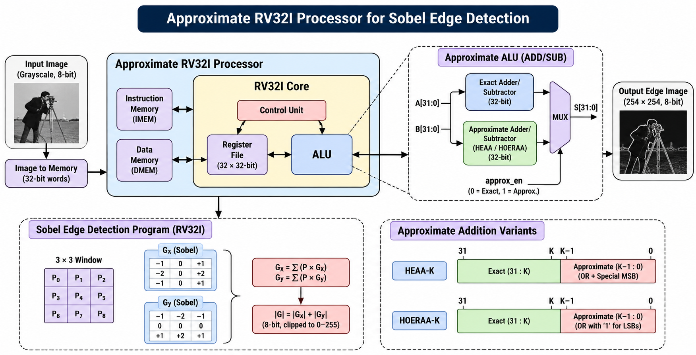

# RISC-V Processor with Hardware-Level Approximate Computing

A **32-bit single-cycle RV32I RISC-V processor** enhanced with configurable approximate arithmetic using **HEAA-4** and **HOERAA-8** adders. The approximate arithmetic units are integrated into the processor ALU and evaluated using a **Sobel edge-detection application** on the standard **Cameraman** image.

The project demonstrates how approximate computing can reduce arithmetic complexity while maintaining acceptable application-level image quality.

---

## 1. Project Overview

This project combines three main components:

1. **32-bit RV32I single-cycle RISC-V processor**
2. **Approximate arithmetic unit**
   - Exact addition/subtraction
   - HEAA-4
   - HOERAA-8
3. **Sobel edge-detection application**

The processor executes a software-generated RV32I program that performs Sobel edge detection on the Cameraman image. The arithmetic mode can be selected to compare exact and approximate computation.

### Main Objective

To investigate the effect of approximate arithmetic on an image-processing workload by replacing the conventional ALU addition/subtraction operation with configurable approximate adders.

---

## 2. Architecture

The processor follows a conventional single-cycle RV32I datapath.



### Main Components

- Program Counter (PC)
- Instruction Memory
- Register File
- Immediate Generator
- Main Control Unit
- ALU Control Unit
- ALU
- Data Memory
- PC Adder
- Approximate Add/Sub Unit

The approximate arithmetic unit is integrated directly into the ALU and can operate in one of three modes:

| Mode | Operation |
|---|---|
| `00` | Exact addition/subtraction |
| `01` | HEAA-4 |
| `10` | HOERAA-8 |

---

## 3. RV32I Processor

The processor implements the required RV32I instruction functionality used by the Sobel application.

The datapath supports the major RV32I instruction formats:

- R-type
- I-type
- S-type
- B-type
- U-type
- J-type

The processor contains:

```text
                 ┌──────────────────┐
                 │ Instruction Mem  │
                 └────────┬─────────┘
                          │
                          ▼
┌──────┐          ┌───────────────┐
│  PC  │─────────►│ Instruction   │
└──┬───┘          │ Decode / Ctrl │
   │              └───────┬───────┘
   │                      │
   │                      ▼
   │              ┌───────────────┐
   └─────────────►│ Register File │
                  └───────┬───────┘
                          │
                          ▼
                  ┌───────────────┐
                  │      ALU      │
                  │ Exact /       │
                  │ HEAA-4 /      │
                  │ HOERAA-8      │
                  └───────┬───────┘
                          │
                          ▼
                  ┌───────────────┐
                  │  Data Memory  │
                  └───────────────┘
```

---

## 4. Approximate Computing

Approximate computing intentionally introduces a controlled amount of numerical error to reduce hardware complexity or improve efficiency.

In this project, approximation is applied to the **least-significant bits (LSBs)** of the adder while the higher-order portion remains exact.

The two approximate adders used are:

- **HEAA-4 — Hybrid Error-Aware Approximate Adder**
- **HOERAA-8 — Higher-Order Error Reduced Approximate Adder**

Both adders preserve an exact upper portion and approximate the lower portion.

---

## 5. HEAA-4

HEAA-4 approximates the **4 least-significant bits** of a 32-bit addition.

```text
32-bit Addition

┌───────────────────────────────────┬───────────────┐
│           Exact Region            │ Approximate   │
│             [31:4]                │  Region [3:0] │
├───────────────────────────────────┼───────────────┤
│             28 bits               │    4 bits     │
└───────────────────────────────────┴───────────────┘
                                    ▲
                                    │
                              Boundary carry
                               C4 = A3 & B3
```

The upper 28 bits are calculated using an exact addition with the boundary carry.

For the approximate region:

```text
C4 = A3 & B3

S3 = C4 ? 0 : (A3 | B3)

S2 = A2 | B2
S1 = A1 | B1
S0 = A0 | B0
```

Therefore, HEAA-4 provides an exact upper portion while simplifying the four least-significant bits.

---

## 6. HOERAA-8

HOERAA-8 approximates the **8 least-significant bits** of a 32-bit addition.

```text
32-bit Addition

┌───────────────────────────────┬──────────────────┐
│        Exact Region           │ Approximate      │
│          [31:8]               │   Region [7:0]   │
├───────────────────────────────┼──────────────────┤
│           24 bits             │      8 bits      │
└───────────────────────────────┴──────────────────┘
                                ▲
                                │
                         Boundary carry
                          C8 = A7 & B7
```

The upper 24 bits are calculated using exact addition together with the boundary carry.

For the approximate region, the implementation uses:

```text
C8 = A7 & B7

S7 = C8 ? (A6 & B6) : (A7 | B7)

S6 = A6 | B6

S5 = 1
S4 = 1
S3 = 1
S2 = 1
S1 = 1
S0 = 1
```

Thus, HOERAA-8 has a larger approximate region than HEAA-4, providing a stronger reduction in exact arithmetic at the cost of increased approximation.

---

## 7. Approximate Add/Sub Unit

The approximate arithmetic unit supports both addition and subtraction.

```text
                         ┌──────────────────┐
              A ────────►│                  │
                         │ Approximate      │
              B ────────►│ Add/Sub Unit     │──────► Result
                         │                  │
        Subtract ───────►│                  │
                         └────────┬─────────┘
                                  │
                         ApproxMode[1:0]
                                  │
              ┌───────────────────┼──────────────────┐
              │                   │                  │
              ▼                   ▼                  ▼
        ┌───────────┐       ┌───────────┐      ┌───────────┐
        │   Exact   │       │  HEAA-4   │      │ HOERAA-8  │
        │   A + B   │       │           │      │           │
        └───────────┘       └───────────┘      └───────────┘
```

The mode selection is:

```text
ApproxMode = 2'b00 → Exact
ApproxMode = 2'b01 → HEAA-4
ApproxMode = 2'b10 → HOERAA-8
```

The same arithmetic unit is used for both ADD and SUB operations.

---

## 8. Sobel Edge Detection

The processor is evaluated using a Sobel edge-detection workload.

The input image used in the project is the standard **Cameraman** image.

### Input Image


The Sobel operator estimates horizontal and vertical image gradients:

```text
Gx =

[-1  0  1]
[-2  0  2]
[-1  0  1]


Gy =

[-1 -2 -1]
[ 0  0  0]
[ 1  2  1]
```

The processor executes the image-processing algorithm using RV32I instructions. The arithmetic operations involved in the Sobel computation are therefore affected by the selected arithmetic mode.

---

## 9. Processing Flow

```text
       Cameraman Image
              │
              ▼
       ┌───────────────┐
       │ Image Data    │
       │ Preparation   │
       └───────┬───────┘
               │
               ▼
       ┌───────────────┐
       │ RV32I Program │
       │ Generation    │
       └───────┬───────┘
               │
               ▼
       ┌─────────────────────┐
       │ RISC-V Single-Cycle │
       │ Processor           │
       └──────────┬──────────┘
                  │
                  ▼
       ┌─────────────────────┐
       │ Arithmetic Mode     │
       │                     │
       │ Exact / HEAA-4 /    │
       │ HOERAA-8            │
       └──────────┬──────────┘
                  │
                  ▼
          Sobel Edge Image
```

---

## 10. Memory Organization

The processor uses separate instruction and data memories.

### Instruction Memory

The RV32I program is stored in:

```text
rtl/program.mem
```

### Data Memory

Image input data and processing data are stored in:

```text
rtl/data.mem
```

The scripts in the `scripts/` directory are used to prepare the image data, generate the RV32I program, and render the RTL output.

---

## 11. Results

The project compares the output produced using:

1. Exact arithmetic
2. HEAA-4
3. HOERAA-8

### Exact Arithmetic


### HEAA-4


### HOERAA-8


The output images demonstrate the application-level effect of introducing approximate arithmetic into the Sobel processing datapath.

The comparison can be used to study the trade-off between arithmetic accuracy and hardware approximation.

---

## 12. Project Structure

```text
RISC_V_with_Approximate_Computing/
│
├── README.md
│
├── architecture/
│   └── arch.png
│
├── output/
│   ├── rtl_output.png
│   ├── rtl_output_heaa.png
│   └── rtl_output_hoeraa.png
│
├── reference_image/
│   ├── cameraman.bmp
│   └── golden_output.png
│
├── rtl/
│   ├── ALU.v
│   ├── ALU_control_unit.v
│   ├── PC.v
│   ├── PC_adder.v
│   ├── adder.v
│   ├── data_memory.v
│   ├── imm_gen.v
│   ├── instruction_mem.v
│   ├── main_control_unit.v
│   ├── processor.v
│   ├── register_file.v
│   │
│   ├── approximate/
│   │   ├── approx_add_sub_unit.v
│   │   ├── heaa_adder.v
│   │   └── hoeraa_adder.v
│   │
│   ├── tb/
│   │   └── tb_sobel_full.v
│   │
│   ├── program.mem
│   └── data.mem
│
└── scripts/
    ├── generate_full_sobel_rv32i.py
    ├── prepare_full_sobel_image.py
    └── render_rtl_sobel_full.py
```

---

## 13. Simulation

The RTL can be simulated using a Verilog/SystemVerilog simulator such as **ModelSim** or **QuestaSim**.

The main testbench is:

```text
rtl/tb/tb_sobel_full.v
```

The simulation uses the generated instruction and data memory files:

```text
rtl/program.mem
rtl/data.mem
```

The approximate arithmetic mode can then be selected to obtain the corresponding output.

---

## 14. Scripts

### `prepare_full_sobel_image.py`

Prepares the Cameraman image and generates the required image data representation for the RTL simulation.

### `generate_full_sobel_rv32i.py`

Generates the RV32I instruction sequence required for the Sobel image-processing workload.

### `render_rtl_sobel_full.py`

Processes the RTL output data and reconstructs the resulting image for visual comparison.

---

## 15. Key Features

- 32-bit RV32I RISC-V processor
- Single-cycle processor architecture
- Verilog RTL implementation
- Configurable exact and approximate arithmetic
- HEAA-4 approximate adder
- HOERAA-8 approximate adder
- Approximate addition and subtraction
- Sobel edge-detection application
- Image-processing workload executed on RISC-V
- RTL simulation and output visualization
- Comparison between exact and approximate outputs

---

## 16. References

1. RISC-V International, *The RISC-V Instruction Set Manual, Volume I: Unprivileged Architecture*. https://docs.riscv.org/

2. P. Balasubramanian and D. Maskell, “Hardware Efficient Approximate Adder Design,” *2018 IEEE Region 10 Conference (TENCON)*, 2018, pp. 806–811. DOI: 10.1109/TENCON.2018.8650127.

3. P. Balasubramanian and D. L. Maskell, “Hardware Optimized and Error Reduced Approximate Adder,” *Electronics*, vol. 8, no. 11, art. 1212, 2019. DOI: 10.3390/electronics8111212.

4. I. Sobel, “An Isotropic 3×3 Image Gradient Operator,” Stanford Artificial Intelligence Project, 1968.
---

## 17. Summary

This project demonstrates the integration of **approximate computing into a RISC-V processor** and evaluates its effect on a practical image-processing application.

The processor supports three arithmetic configurations:

```text
                 ┌───────────────┐
                 │   RV32I CPU   │
                 └───────┬───────┘
                         │
                         ▼
                 ┌───────────────┐
                 │      ALU      │
                 └───────┬───────┘
                         │
             ┌───────────┼───────────┐
             │           │           │
             ▼           ▼           ▼
         ┌───────┐   ┌───────┐   ┌─────────┐
         │ Exact │   │HEAA-4 │   │HOERAA-8 │
         └───────┘   └───────┘   └─────────┘
             │           │           │
             └───────────┼───────────┘
                         ▼
                  Sobel Processing
                         │
                         ▼
                   Edge Detection
```

The project provides a complete RTL-level demonstration of how approximate arithmetic can be incorporated into a processor datapath and evaluated using an image-processing workload.
